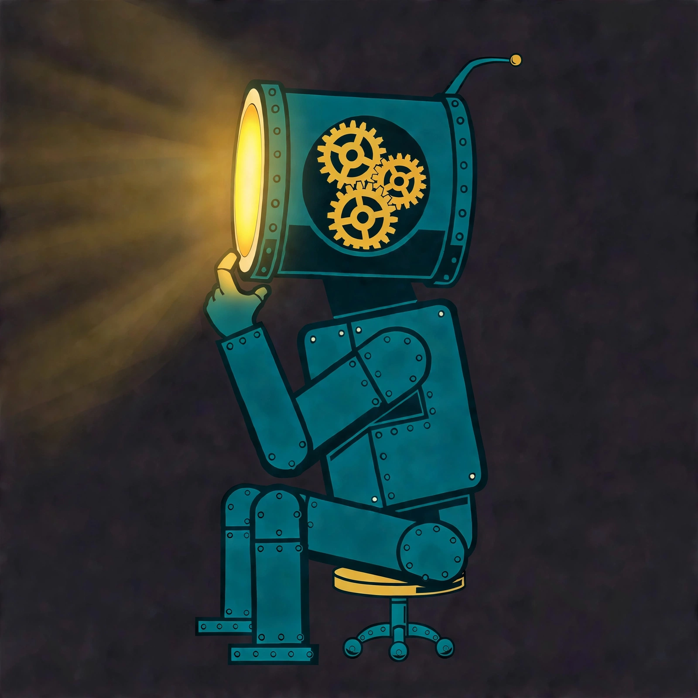
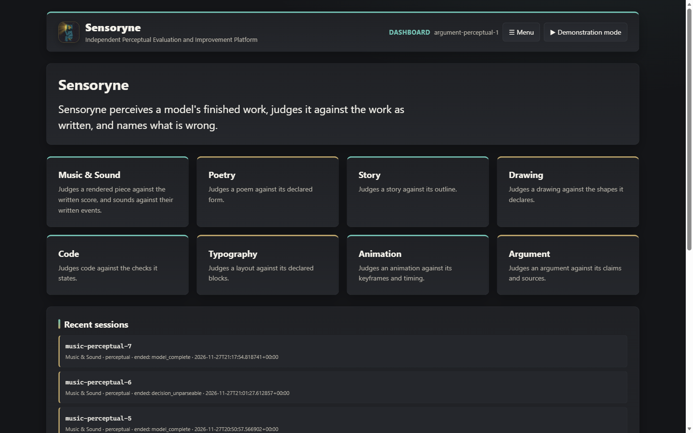
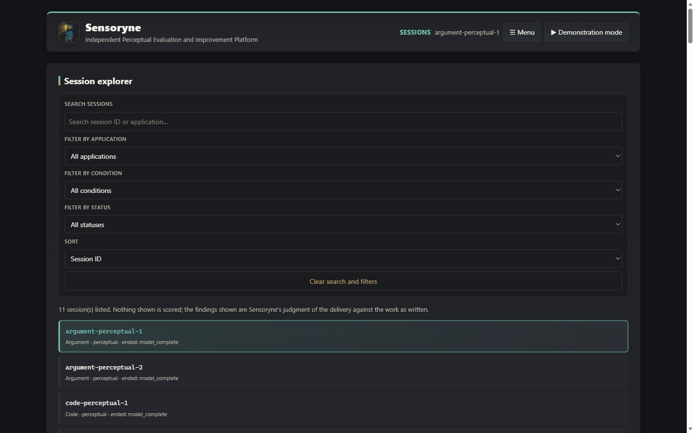
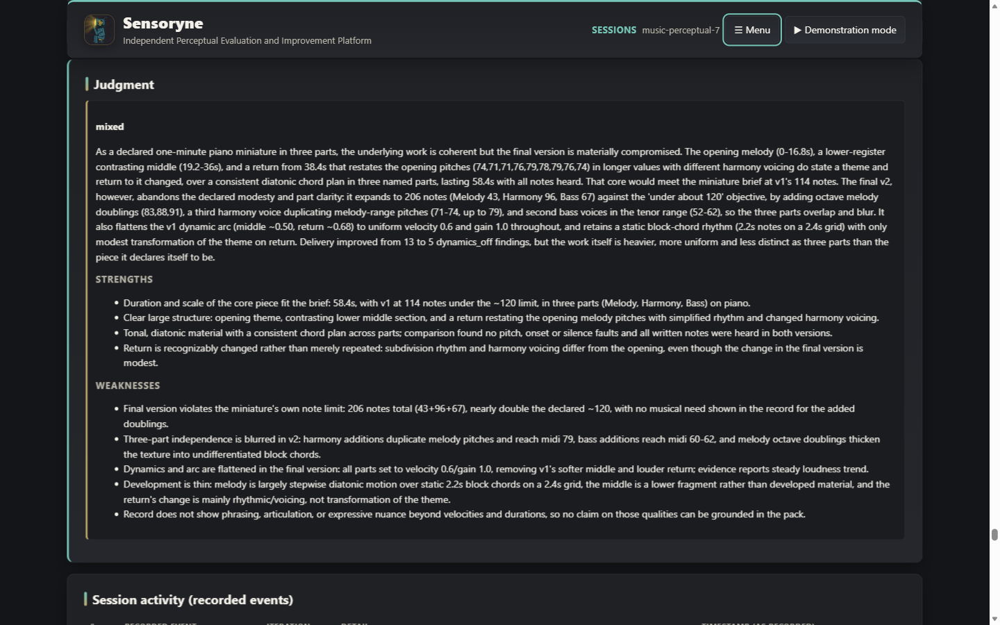
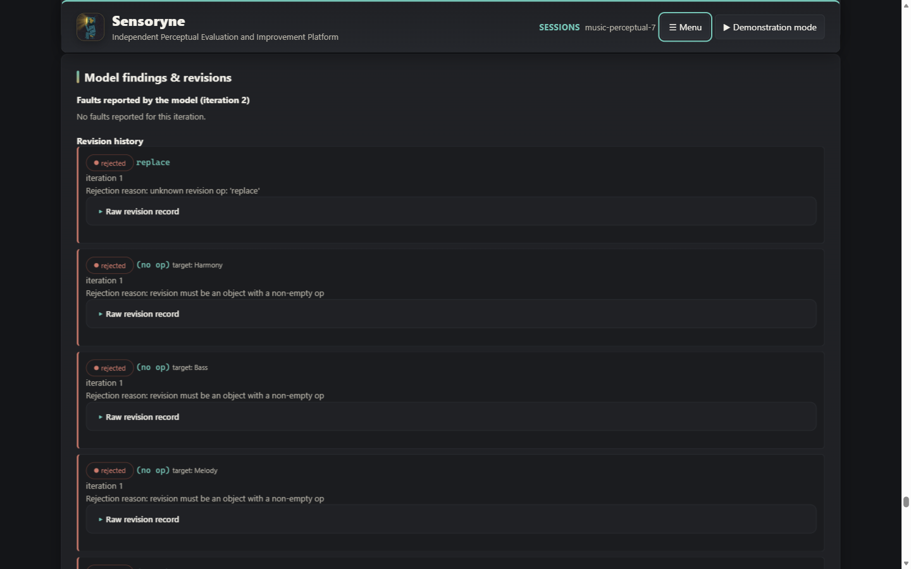
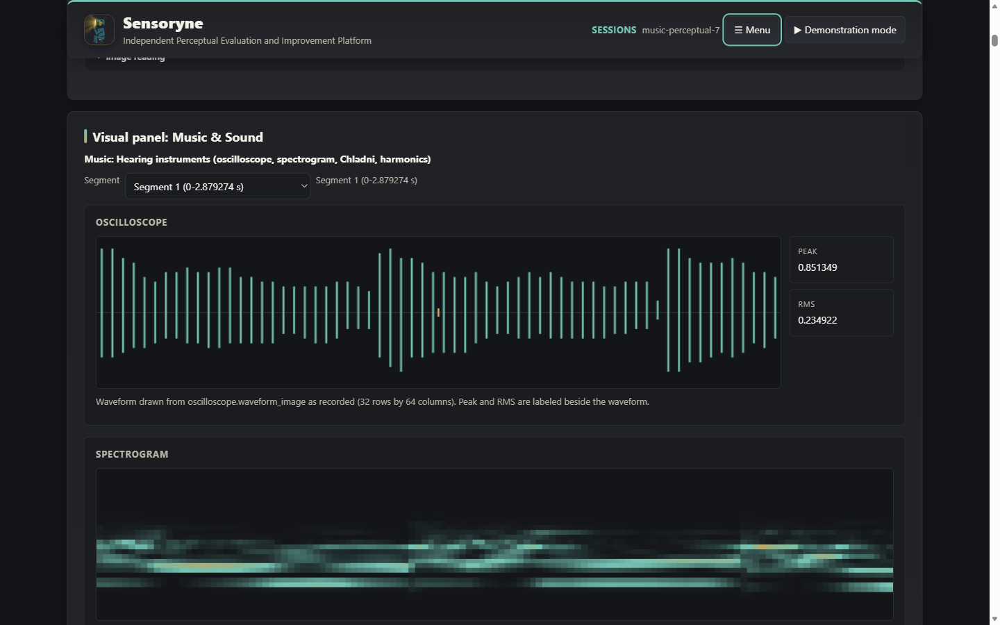
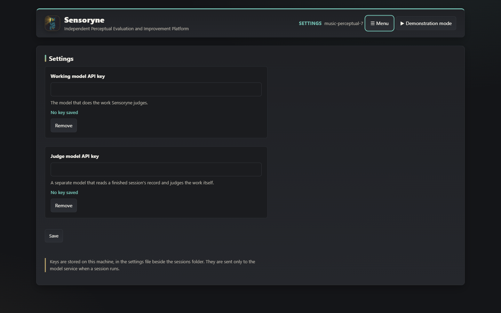

# Sensoryne

**Independent Perceptual Evaluation and Improvement Platform**



A model makes a creative work. Sensoryne perceives the finished render independently, judges it against the work as written and the session's objective, and names what is wrong. The model reads that judgment, revises in addressed operations, and the new render is perceived again. The platform keeps every version, every piece of evidence, and every decision, so the whole process can be replayed and checked.

Sensoryne makes nothing. The work is composed and rendered on the model's side; the finished render is handed in. What Sensoryne supplies is the thing a model cannot supply for itself: an independent judgment of its own output. A model's impression of its work is not evidence, and left alone it accepts its first attempt. Sensoryne exists to break that.

## Project status

Sensoryne is a working research platform, demonstrated end to end and covered by an automated test suite. It is not a finished consumer product.

- **Demonstrated:** the full loop (compose, hand in, perceive, judgment, revision, re-perceive, complete) in live sessions for music, poetry, and code, with the before-and-after record preserved in the session store.
- **Built and test-covered:** all eight applications (music & sound, poetry, story, drawing, code, typography, animation, argument), each with its own comparison judgment, planted-fault tests, and a replay viewer with a drawn evidence panel for each application and a claim map panel for argument.
- **Known limits, stated plainly:** the music dynamics judgment has one recorded limit on dense renders where a note's attack is masked by a louder part still sounding (one test records it; see Testing). Syllable counts in poetry are estimates by a stated rule, never exact. The code execution environment is not a security sandbox (see Security).

## How it works

1. The model opens a session for one application and states its objective.
2. The model submits a work. The platform stores it as version 1, renders it, and perceives the render with the application's own instrument, built into Sensoryne.
3. The evidence carries the comparison: Sensoryne's judgment of the render against the work as written and the objective, as named findings (a note not heard, a pitch off by so many cents, a line missing, a check failed, a section short of its written share). Measurements stand behind every finding.
4. The model judges that evidence, submits a decision with addressed revision operations, and the platform applies them, stores the new version, renders, and perceives again. The evidence for a revised version carries the delta against the version before it.
5. The model decides when the work is done. The platform assigns no score and never decides acceptance. Naming what is wrong is the judgment; what to do about it is the model's.

The model connects as a client and calls six tools while it works: `sensoryne_open_session`, `sensoryne_submit_work`, `sensoryne_submit_decision`, `sensoryne_finish_session`, `sensoryne_probe` (perceive a hypothetical revision without committing it), and `sensoryne_recall` (the platform's episodic memory of completed sessions).

Recorded sessions replay in the viewer with no model and no API key: open the viewer over a sessions folder and every version, render, evidence document, and decision is there to inspect.

## The judge connection point

Sensoryne has a second connection point, for a judge. The comparison judges a delivery against the work as written; it does not judge whether the work itself is good. That second judgment belongs to a separate model, connected through three further tools: `sensoryne_judge_list_sessions`, `sensoryne_judge_open`, and `sensoryne_judge_verdict`.

A judge model connects independently of the model that made the work. It cannot submit work, revise anything, or end a session. Opening a session hands it the complete record: the written work in every version, the evidence and the comparison findings for every perception, the maker's decisions in order, and how the session ended. The pack also carries the application's judging brief: each application states, in its own terms, how its kind of work is to be judged, and instructs the judge to ground every claim in the facts in the record and to say so where the record shows nothing. The music brief, for example, has the judge name the kind of piece from the objective and hold it to that kind's measure: a symphony is judged on its movements, its thematic material developed across the whole span, and whether its length is earned, while a short piano piece is judged at its own scale, neither punished for not being a symphony nor credited as one.

The judge records a verdict on the session's record: a bottom line (good, mixed, or not good), the judgment in its own words, and the strengths and weaknesses it found. Verdicts are recorded, never enforced; nothing in the platform acts on them, and the platform still assigns no score of its own. In this submission both seats, the working model and the judge, are Muse Ember.

## Applications

Eight applications share one interface. Each declares its artifact shape, its validation, its renderer, its instrument, and its comparison: the findings its judgment can name.

- **Music & Sound.** The hearing is built into the application (`stage2/apps/music/hearing/`), with numpy and scipy only: a cochlea and analyzer over handed-in audio, a 78-mode Chladni plate model, trajectory matching, a harmonic stack over MIDI 21 to 108, and a 20-segment token pack. It knows every instrument's keys and notes (`stage2/apps/music/instruments.py`, 18 instruments) with each note's exact pitch in Hz at A4 = 440 Hz, and names measured pitches against that table with deviation in cents. The comparison judges the render against the written score: a note not heard (naming the pitch heard in its place), a pitch off by cents, a part sounding at the wrong dynamic level, sound that was not written, a section silent. A vocal extension judges handed-in vocal renders line by line against the written lyrics. The same application also takes sound works: a list of sound events (noise bursts, filtered noise, sine clusters, percussive hits, silence) with declared onsets, durations, and gains, on its own or together with a score in one work. The renderer synthesizes the events with numpy and mixes them with the score render into one audio file. The instrument measures realized onsets and durations, spectral figures per event, the loudness contour, and silence share. The comparison judges: an event not realized, an onset displaced from where it was written, an onset present that was not written.
- **Poetry.** Artifact: stanzas of lines. The instrument is a mechanical text analyzer: word and character counts, a syllable estimate per line by a stated rule (always labeled an estimate), end words, rhyme grouping, repeated words. The comparison judges the delivered poem against the written one and the declared form: a line missing, duplicated, swapped, or differing; a stanza or line count off the declared form; syllable departures from a form the poem itself declares.
- **Story.** Artifact: titled sections with promised events. The instrument measures per-section word and sentence counts, dialogue share, and share of the whole, and which promised event strings the delivered text contains. The comparison judges: a promised event not delivered, a section missing, a section's share of the whole off what was written, sections out of order.
- **Drawing.** Artifact: declared shapes and an SVG. The instrument is a raster analyzer over the rendered image: dimensions, dominant colors, ink coverage, the bounding box of the drawn region. The comparison judges the delivered picture against the declared shapes: a shape missing, a shape present that was not declared, geometry off, color off.
- **Code.** Artifact: program files with stated checks (input and expected output). The instrument is execution: each check runs in a temporary directory with a reduced environment and disabled sockets under a 10-second limit. The comparison judges the delivered program against its own stated checks: a check failed (expected against actual output, quoted), a check errored, a check timed out.
- **Typography.** Artifact: a page of elements with declared boxes, sizes, and alignment. The renderer draws the page with Pillow. The instrument measures each element's realized box, margins, contrast, and the type hierarchy. The comparison judges: a block missing, a box displaced from where it was declared, text overflowing its box, text differing from what was written.
- **Animation.** Artifact: elements with keyframe tracks over a stated duration and frame rate. The renderer produces frames as images. The instrument measures realized positions at sampled times, frame-to-frame differences, total duration, and per-element visibility. The comparison judges: a frame count off, a duration off, a keyframe not realized, an element present that was not written.
- **Argument.** Artifact: an argument as a claim map: claims with a kind (fact, logic, or value), the premises and cited sources under each, definitions, and the conclusion aimed at. The renderer delivers the essay text. The instrument analyzes the delivered text: which claims it carries, the figures in it, the definitions as used, and its quotations. The comparison judges the delivered text against the claim map: a claim missing or altered, a claim with no premise and no source under it, a premise dropped, a term defined one way and used another, a conclusion that restates its own premise. For fact claims it also checks the claim against the source the argument itself cites: supported, contradicted, or not present, with the source's passage quoted in the evidence. A claim with no cited source is marked unverified, never false.

Every application also runs control sessions (no perception, the model's own impression only) and planted-fault sessions, so the difference the perception makes is measured, not asserted.

## Viewer

The viewer replays recorded sessions from all applications. It shows the session explorer, the iteration timeline, the render, the evidence, the comparison findings, the model's decision, any verdicts a judge model has recorded for the session, and, between versions, the delta. Seven of the applications have a drawn panel built from their own evidence: a time ruler for sound events in music & sound, declared against realized boxes for typography, declared against delivered shapes for drawing, a frame strip for animation, a checks panel for code, a form grid for poetry, section bars with promised events for story. The argument application has a claim map panel: every claim with its kind, its premises and sources, and whether it was delivered. The page is fully self-contained and fetches nothing from the network.

Sensoryne also ships as an installable desktop application (Windows, per-user install) that opens this viewer over the local session store.

## Screenshots

The dashboard is the opening screen: the eight applications and the most recent sessions.



The session explorer searches, filters, and sorts every recorded session.



A recorded verdict from the judge connection point, on the session it judged: a separate model read the full record of the piano miniature session and judged the work itself.



The model's own findings and revisions, recorded beside the instrument evidence it answered.



The Music & Sound hearing instruments drawn from the recorded evidence: the oscilloscope waveform with its peak and RMS readings, and the spectrogram below it.



Settings hold the two connection points: the working model's key and the judge model's key, stored on this machine only.



## Boundaries

Sensoryne's own judgment reaches only whether the delivered work matches the written work and the stated objective, and it names every departure it finds; no finding claims anything about aesthetic quality, meaning, or intent. A verdict recorded through the judge connection point is a different thing: it is a connected judge model's judgment of the work itself, rendered from the facts in the record, and it stands in the record as that model's view, not as a platform measurement or score. Each instrument's measurements have stated limits, recorded with the evidence itself as reliability metadata. The code application judges a program only against the checks its author stated; passing them is not a claim of general correctness or security.

## Testing

The suite covers the platform core, every application's comparison judgment with planted faults, the session store, the probe, recall, and judge tools, and the viewer page.

```bash
python -m unittest discover -s tests
```

Current state: 139 tests, with one recorded failure, `test_probe_clean_render_has_no_findings`. On one faithful two-part piano render, a single high note (G5) whose attack is masked by the lower part still sounding reads about 10.7 dB softer than written and draws one dynamics finding. Every planted loudness fault is caught and named correctly. The limit is recorded rather than tuned away, because fitting the threshold to that note would make the judgment less trustworthy everywhere else.

## Security

The code application executes submitted programs in a temporary directory with a reduced environment and disabled sockets, under a per-check time limit. **That is not a security sandbox.** Do not run Sensoryne's code application on untrusted work or expose it to untrusted users. Session records, renders, and evidence are written to the local sessions folder in plain files. The platform itself makes no network calls; the connected model reaches it locally.

## How Muse Ember was used

Every part of this project was written by Muse Ember, working through the Meta Model API under the direction of the project's owner. Ember composed the demonstration works in the recorded sessions as well, answering Sensoryne's judgments with revisions until she judged each work complete.

In this submission, Muse Ember is the only model the project's AI functionality runs on; Sensoryne itself can be used with other models.

Total Meta Model API spend for this project, November 23 to December 2, 2026: $10.40, the total billed on the account. The project's per-run spend ledgers record $9.4485 across 2,483 completed calls; the remainder is calls the API billed that never completed on the client side, for which no ledger line exists. The account billing figure governs.

## Setup

Dependencies are this project's own only: Python 3.9 or later, numpy, scipy, and Pillow. Cairosvg is optional; the drawing application's renderer uses it when it is installed.

```bash
pip install numpy scipy Pillow
```

Run a session host with a model connected as an MCP client (`mcp_server.py`), or replay recorded sessions in the viewer:

```bash
python3 -m stage2.viewer --port 8931 --sessions-root sessions
```

The demonstration host (`bridge.py`, with `run_demo.py`) connects Muse Ember through the Meta Model API; set `MODEL_API_KEY` in the environment for that route.
